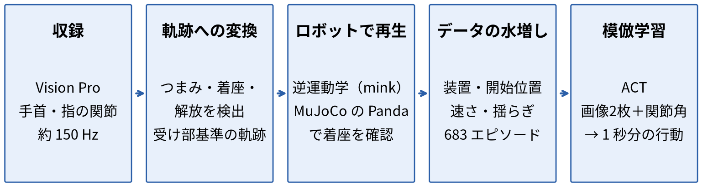
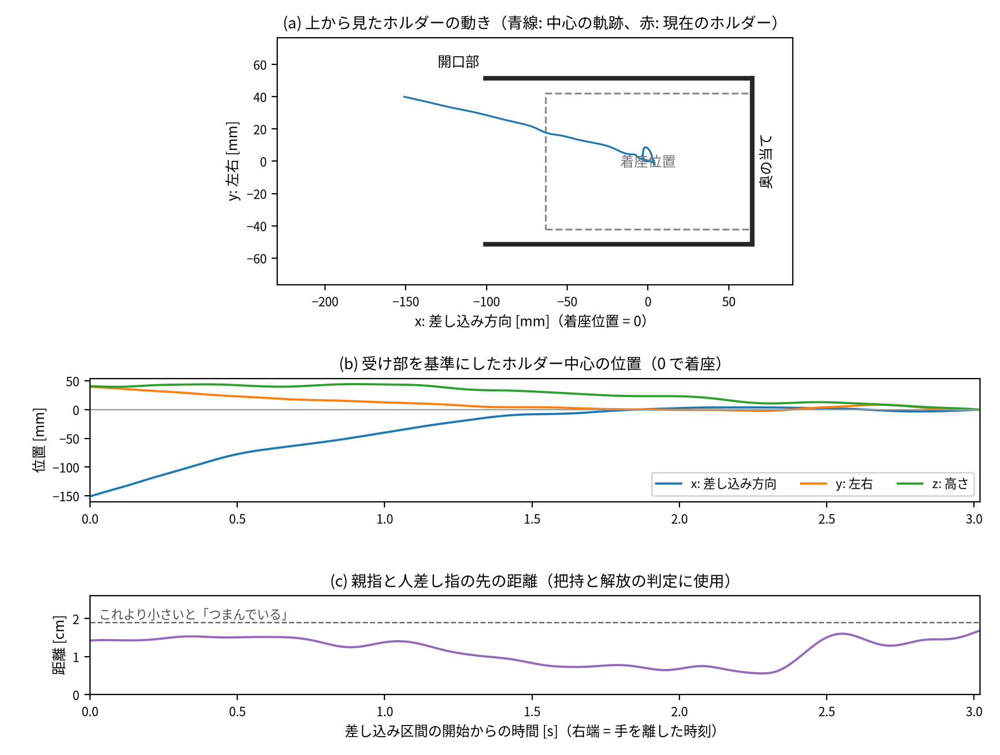
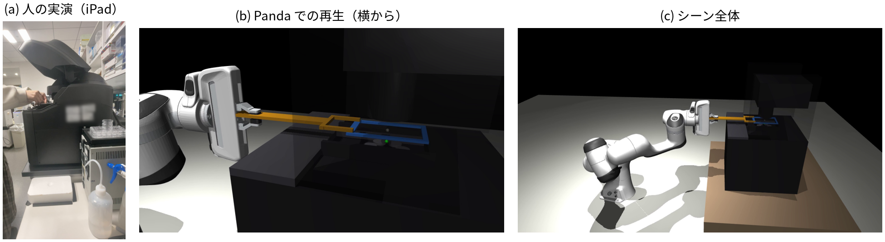
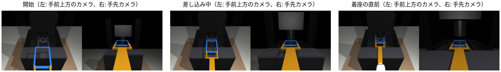
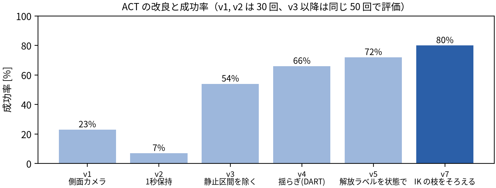
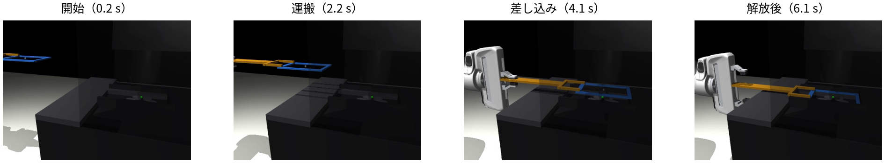

# 病理標本ホルダーの差し込み動作の模倣学習 ―― Apple Vision Pro による人の実演から Panda アームの ACT 方策まで

<div class="abstract" markdown="1">

**要旨** ―― 病理標本スキャナーにスライドホルダーを差し込む作業を対象に、人の実演からロボットの方策を学習する一連の手順を構築した。Apple Vision Pro で作業者の手の関節を収録し、受け部を基準にしたホルダーの軌跡に変換したうえで、Franka Emika Panda アームの動きとして物理シミュレーター MuJoCo で再生した。人の成功試行 22 本はすべてロボットでも着座し、着座位置からのずれは中央値 0.3 mm であった。これを装置の位置などを変えて 683 エピソードに水増しし、模倣学習の手法 ACT（Action Chunking with Transformers）を学習した。学習に使っていない装置の位置と開始位置での成功率は 76%（100 回中 76 回）であり、光学系への接触は 0 回であった。学習を安定させるうえでは、モデルの変更よりもデータ側の整備（静止区間の除去、実行時の揺らぎの付加、状態にもとづく解放ラベル、逆運動学の解の統一）の効果が大きかった。

**キーワード**: 模倣学習、ACT、人の実演、リターゲティング、MuJoCo、デジタル病理、ラボオートメーション

</div>

## 1. はじめに

病理標本（スライド）をスキャナーでデジタル画像にするホールスライドイメージング（WSI）は、研究と臨床の両方で普及が進んでいる [1, 2]。同時に、ウェット作業を含む実験室の自動化も進みつつあり、移動ロボットによる化学実験の自律化 [3] や、双腕ロボットによる生命科学実験の自動化 [4] などが報告されている [5]。

一方、病理検査室では、標本の作製からスキャンまでの多くの工程を臨床検査技師が手作業で担っており、時間と人件費の負担が大きい。標本作製からスキャンまでの全工程をロボットで自動化できれば得られる恩恵は大きいが、スキャナーへの標本の装填のような個別の作業をロボットに教える研究や、そのための公開データは限られている。

そこで本研究では、スキャナーの所定の位置に、病理標本を載せたホルダーを差し込むという実世界の作業を対象に、人の実演の収録から、シミュレーション上でのロボットによる再生、模倣学習による方策の獲得までを一貫して行えるかを検証した。

本研究の貢献は次の 3 点である。

1. Vision Pro の手の追跡だけから、受け部を基準にしたホルダーの軌跡を自動で切り出す手順を作り、iPad で同時に撮影した動画と照合して検証した。
2. 実測寸法にもとづく装置のモデルと、吸着パッド付きのパドルを持つ Panda を MuJoCo 上に構築し、人の 22 本の実演をすべてロボットで再現した。
3. ACT の学習で生じた失敗を分析し、データ側の 4 つの整備で成功率を 23% から 76〜80% に改善した。

## 2. 関連研究

**模倣学習** ―― 人の実演から方策を学ぶ模倣学習では、学習した方策が実演から少しずれた状態に入ると誤差が累積する問題が知られている [6]。DART [7] は、実演の収録中に実行する行動へ雑音を加え、ずれた状態から戻る行動を学習データに含めることでこれを緩和する。ACT [8] は、Transformer [9] と条件付き VAE [10] を用いて、画像と関節角から一定時間分の行動列（action chunk）を予測し、時間的アンサンブルでつなぐことで、精密な操作を少数の実演から学習できることを示した。拡散モデルを用いた Diffusion Policy [11] も同様の目的で広く使われている。

**人の実演の収録とリターゲティング** ―― 人の手の動画からロボットの動きを作る研究として DexMV [12] があり、手持ちのグリッパーで実演を集める UMI [13] も提案されている。Apple Vision Pro の手の追跡をロボットの遠隔操作やデータ収集に用いる取り組みもある [14]。本研究は、作業者がふだんどおり素手で行う作業を Vision Pro で収録し、ロボットの手先の軌跡に変換する。

**シミュレーション** ―― 物理シミュレーターには MuJoCo [15] を、ロボットのモデルには MuJoCo Menagerie [16] の Franka Emika Panda [17] を、逆運動学には mink [18] を用いた。

## 3. 課題の設定

対象の作業は、スライド 3 枚を載せたホルダー（127×84×4 mm、中空の枠、スライドを含めて約 50 g）を、スキャナー前面の開口部（幅 103 mm、奥行き 165 mm）に差し込み、奥の当てまで送って置く動作である。装置は倒立型で、ホルダーの 8 mm 下に対物レンズが、45 mm 上に照明がある（寸法は実測）。

範囲は次のように限定した。

- **差し込み（位置決め）のみを対象とする** ―― 実際の運用では、作業台でホルダーにスライドを置く工程が先にある。スライドはばねに当てて止めるため、ガラスとばねの接触を安定してシミュレーションするのが難しい。この工程は収録したが、学習の対象からは外した。
- **はめ込みは対象外とする** ―― 収録の後、実機では所定の位置に置いた後に、はめ込む操作が必要であることが分かった。データの一貫性を保つため、全収録を「所定の位置に置く」までで統一し、はめ込みは今後の課題とした。
- **ロボットはアーム 1 本で行う** ―― 人は両手を使う。右手でホルダーをつまんで差し込み、左手の人差し指をホルダーの左側に添えて支える。収録データでは、差し込みの間、左手の人差し指は受け部の中心から左に 6〜9 cm、ステージ面の上下 2 cm 以内にあり、ホルダーと一緒に奥へ進んでいた。本研究のロボットは Panda アーム 1 本であり、左手の支えは再現しない。代わりに、吸着パッド 2 個の付いた硬いパドルでホルダーを固定して持ち、ホルダーが手先で傾いたりずれたりしないようにして、左手の役割を把持で代用した。ロボットの動きの元にしたのは、右手のつまみ点の軌跡だけである。

<figure><figcaption>図 1　本研究の全体の流れ</figcaption></figure>

## 4. 方法

### 4.1 収録

Vision Pro の手の追跡を avp_stream [14] で受信し、両手の手首と指の関節の姿勢を約 150 Hz で記録した。装置の近くに ArUco マーカー [19] を固定し、受け部の位置の目安とした。各試行の始めと終わりに、何も持たずに右手を 3 回上下させる合図を入れ、手首の高さの山から作業の区間を自動で検出した。

**Vision Pro のカメラ映像を使わなかった理由** ―― 一般の開発者向けアプリが Vision Pro から取得できるのは手や頭の追跡結果であり、本体の前面カメラ（メインカメラ）の映像を取得するには、企業向けの Enterprise API を使う必要があり、その利用には Apple が管理する専用の権限（managed entitlement）と、開発者アカウントに紐づいたライセンスファイルが必要である [20]。本研究で用いた avp_stream も、手と頭の追跡結果だけを送る仕組みである。そこで、作業の映像は iPad で同時に撮影し、動画の作成時刻と収録開始の時刻の差で各試行と対応づけた。iPad の映像は、作業区間と解放の時刻が正しく検出できているかの確認に用いた。

収録は予備収録（3 本）と本番収録（19 本）で、成功した計 22 本を用いた。

### 4.2 人の動きから受け部基準のホルダー軌跡へ

1. 親指と人差し指の先の中点を「つまみ点」とし、4 Hz の低域フィルタをかける。
2. 合図の間で、受け部の付近（マーカーから水平 0.35 m 以内）で、つまんだまま 0.8 秒以上止まった最後の区間を着座とし、その後に指が開くか手が動き出した時刻を解放とする。
3. 着座時の姿勢から受け部座標を作る（x：差し込み方向、y：左、z：上）。差し込み方向は、着座の手前 0.15 m 以内の移動の向きから決める。
4. 着座点から 0.30 m 以内で、かつ左右のずれが 4 cm 以内にそろってからを差し込み区間とする。

Vision Pro から分かるのは手の姿勢だけであり、手の中でのホルダーの傾きや持ち替えは観測できない。実際、手首の向きをそのままホルダーの向きとみなすと、持ち替えによってロール角が約 100 度変化する試行があった。そこで、ホルダーは常に水平（受け部に入る姿勢）とし、人のデータからはつまみ点の位置と時間だけを用いた。図 2 に変換結果の例を示す。

本番収録では、次の点で検出を改良した。合図の最後に手を上げたまま待つと山の幅が広がって合図から外れていたため、幅の上限を外した。終わりの合図をやり直した試行に対応するため、最初の 2 つの合図の間を作業区間とした。着座して押さえている間に指がゆるむ試行（つまみ距離 2〜3 cm）に対応するため、見つからない場合に限って基準をゆるめて受け部付近を探し直すようにした。さらに、作業台でスライドを置く場面を解放と誤認した例があったため、受け部付近以外は探さないようにした。最終的に、全試行の解放の瞬間を iPad の映像で確認した。

<figure><figcaption>図 2　人の実演から求めたホルダーの軌跡の例（本番収録の 1 本）。(a) 上から見た動き、(b) 受け部を基準にした位置、(c) つまみ距離</figcaption></figure>

### 4.3 ロボットでの再生

MuJoCo 3.16 上に、MuJoCo Menagerie の Panda と、実測寸法にもとづく装置のモデルを置いた（図 3）。標準のグリッパーでは手の本体が装置の前面にぶつかるため、手先に長さ 0.25 m の二股のパドルを付け、先端の直径 8 mm の吸着パッド 2 個でホルダー手前の帯の左右端を持つ構成とした（シミュレーションでは weld 拘束で表現）。

逆運動学は mink（二次計画法）で解いた。着座姿勢を基準解として、時間を逆向きにたどって各時刻の関節角を求める。Panda の基部は机より 0.20 m 低い位置に置き、作業高さが肩の高さに重なる特異姿勢を避けた。人の押し込みすぎ（奥の当て・側壁・支持面を越える分）は、目標を拘束の内側に射影して止めた。制御は、実機と同様に重力補償を入れた関節位置制御である。

成功は、解放から 1 秒後にホルダー中心のずれが 5 mm 以内かつ 3 度以内で、対物レンズと照明に接触していないことと定義した。

<figure><figcaption>図 3　(a) iPad で撮影した人の実演、(b) 同じ試行を Panda で再生した様子、(c) シミュレーションのシーン全体</figcaption></figure>

### 4.4 学習データの作成

22 本の軌跡のそれぞれから 40 エピソードを作り、毎回次をランダムに変えた。

- 装置の位置：前後・左右に ±3 cm
- ホルダーの開始位置：±3 cm（着座点に近づくほどずらしを小さくし、着座点では 0）
- 再生の速さ：0.85〜1.15 倍
- 実行する関節目標への揺らぎ（DART [7] と同じ考え方）：0.2〜1 Hz の正弦波の和、最大 0.015 rad。ラベルは計画どおりの行動のままとし、差し込みの最後の 0.3 秒で揺らぎを 0 にする。

着座に成功し、逆運動学の誤差が 2 mm 以下のエピソードだけを残した（880 本中 683 本）。観測は 2 台のカメラ（開口部の手前上方から見下ろすカメラと手先カメラ、各 240×180 画素、図 4）の画像と、関節角および指の開きである。行動は、7 関節の目標角と解放の指令（50 Hz）である。

学習を安定させるため、データ側で次の 4 点を整えた（5.2 節で効果を示す）。

- **静止区間の除去** ―― 動き出す前の静止と、着座後の静止を除いた。同じ観測に「止まる」と「動く」（あるいは「保持」と「解放」）の両方が対応すると、方策が動き出さない、あるいは離さなくなる。
- **状態にもとづく解放ラベル** ―― 元の解放の 0.5 秒前以降で、ホルダーが着座位置から 2 mm 以内に入った時刻から解放のラベルを 1 とした。
- **逆運動学の解の統一** ―― Panda は 7 関節の冗長なアームであり、配置によって腕の姿勢が別の解に移っていた。手先が 30 cm 動く間に関節が最大 4.8 rad 回るエピソードもあった。着座姿勢の候補を多数求め、逆向きにたどったときの関節の動きが最小の候補を基準解とし、全エピソードをそこから解いた。その結果、関節の動く幅は最大 1.2 rad に収まった。
- **カメラの配置** ―― 側面のカメラでは装置の左右のずれが奥行き方向の変化として写り、見分けにくい。そこで、開口部の手前上方から見下ろすカメラに替えた。

<figure><figcaption>図 4　方策への入力画像の例（各組の左が手前上方のカメラ、右が手先カメラ）</figcaption></figure>

### 4.5 ACT の学習と評価

ACT [8] を実装した。ResNet-18 [21]（ImageNet で事前学習）で画像を特徴に変換し、Transformer（エンコーダ 4 層、デコーダ 4 層、512 次元）で 50 ステップ（1 秒）分の行動列を出力する。条件付き VAE の潜在変数は 32 次元、KL 項の重みは 10 とした。元の軌跡のうち 3 本から作ったエピソードは学習に使わず、検証に用いた。学習は 40,000 ステップ、バッチサイズ 64、AdamW（学習率 1e-4、バックボーンは 1e-5）、bfloat16 で行い、GPU 1 枚（RTX PRO 6000）で約 37 分を要した。推論では、時間的アンサンブル（重み exp(−0.01·i)）で行動列をつなぎ、解放の指令は 0.5 でしきい値処理した。

評価では、学習とは別の乱数で装置の位置と開始位置を決め（腕が届かない配置は除く）、4.3 節の基準で成否を判定した。

## 5. 結果

### 5.1 人の実演のロボットでの再生

表 1 に示すとおり、22 本すべてが成功の基準を満たした。1 本だけ、右の側壁に一瞬当たり、手先とホルダーの間に最大 53 N の力がかかった（時間の 95% は 0.8 N 以下）。

<div class="caption">表 1　人の実演 22 本をロボットで再生した結果</div>

| 項目 | 最小 | 中央値 | 最大 |
|---|---|---|---|
| 差し込み区間の長さ [s] | 3.0 | 4.4 | 6.8 |
| 着座のずれ [mm] | 0.03 | 0.3 | 3.2 |
| 逆運動学の誤差 [mm] | 0.01 | 0.06 | 0.19 |
| 手先とホルダーの間の力（95 パーセンタイル）[N] | 0.7 | 0.9 | 1.5 |

### 5.2 ACT

最終版（v7）の成功率は、学習とは別の乱数で決めた 100 エピソードで **76%** であった。光学系への接触は 0 回、成功時の着座のずれは中央値 1.8 mm、解放までの時間は中央値 5.6 秒であった。失敗 24 回の内訳は、着座位置から 5 mm 以内まで来て離さない例が 10 回、5 mm より手前で止まって離さない例が 6 回、離したが 5 mm を超えてずれていた例が 8 回であった。図 6 に成功例を示す。

図 5 と表 2 に、改良の経緯を示す。v1 の失敗の多くは、奥行きは合っているのに左右に 5〜12 mm ずれて止まるものであった。ずれの大きさは装置の左右のずらしの約 0.4 倍であり、方策が画像から装置の左右の位置を読み取れていなかったことを示している。v2 では、着座後に 1 秒保持してから離すデータにしたところ、ほとんど離さなくなった。保持の間は観測がほとんど変わらないため、同じ観測に対して「保持」と「解放」の両方が正解になり、解放の判断ができなくなったと考えられる。以降、静止区間の除去（v3）、実行時の揺らぎ（v4）、状態にもとづく解放ラベル（v5）、逆運動学の解の統一（v7）によって、成功率は 80% まで上がった。

<div class="caption">表 2　ACT の改良の経緯（v1・v2 は 30 回、v3 以降は同じ 50 回で評価）</div>

| 版 | 変更点 | 成功率 | 主な失敗 |
|---|---|---|---|
| v1 | 側面カメラ＋手先カメラ、434 エピソード | 23% | 左右に 5〜12 mm ずれて止まる |
| v2 | 前方上方カメラ、着座後に 1 秒保持 | 7% | 離さない |
| v3 | 静止区間を除き、着座後 0.1 秒で離す | 54% | 着座の近くで離さない |
| v4 | 実行時の揺らぎ（DART） | 66% | 着座の近くで離さない |
| v5 | 状態にもとづく解放ラベル（2 mm） | 72% | 開始姿勢から動かない |
| v7 | 逆運動学の解の統一 | **80%** | 5〜7 mm のずれ |

<figure><figcaption>図 5　ACT の改良と成功率</figcaption></figure>

<figure><figcaption>図 6　学習した ACT による差し込みの例（成功、着座のずれ 2.2 mm）</figcaption></figure>

## 6. 考察と限界

**データ側の整備の重要性** ―― 成功率の改善は、いずれもモデルの構造ではなく学習データの整備によるものであった。とくに、同じ観測に異なる行動が対応する区間（静止区間）と、同じ作業に異なる腕の姿勢が混ざること（逆運動学の解の枝）は、どちらも方策の失敗として直接現れた。人の実演をロボットのデータに変換する際には、見た目の軌跡が正しいだけでなく、観測から行動が一意に決まるデータになっているかを確認する必要があると考えられる。

**ホルダーの向き** ―― Vision Pro の手の追跡からはホルダーの向きが分からないため、水平と仮定した（4.1 節）。持ち替えを伴う動作や、傾けて差し込む動作を再現するには、外部の RGB-D カメラと物体の 6 次元姿勢推定（例えば FoundationPose [22]）を組み合わせて、ホルダーの姿勢を直接観測する必要がある。

**把持** ―― 吸着パッドの吸着力は、−60 kPa でパッド 1 個あたり約 3 N、2 個で約 6 N と見積もられる。再生中に手先とホルダーの間にかかる力は通常 1.5 N 以下であり、この範囲に収まる。

**対象外とした工程とシミュレーションの忠実度** ―― はめ込み、スライドの配置、左手による支えは対象外とした（3 章）。装置は実測寸法から作った簡略モデルであり、照明の半径などは写真からの推定である。また、評価はすべてシミュレーション上で行っており、実機での検証は行っていない。

## 7. まとめと今後の課題

Vision Pro で収録した人の実演から、受け部を基準にしたホルダーの軌跡を作り、Panda アームで再生し、ACT を学習する一連の手順を構築した。学習した方策は、学習に使っていない装置の位置で 76% の成功率を示した。今後の課題は、はめ込み動作の収録と力の情報を用いた方策、スライドをホルダーに置く工程の追加、ホルダーの姿勢の直接観測、そして実機の Panda での検証である。

## 参考文献

<div class="refs" markdown="1">

1. L. Pantanowitz, P. N. Valenstein, A. J. Evans, et al. Review of the current state of whole slide imaging in pathology. *Journal of Pathology Informatics*, 2:36, 2011.
2. M. K. K. Niazi, A. V. Parwani, M. N. Gurcan. Digital pathology and artificial intelligence. *The Lancet Oncology*, 20(5):e253–e261, 2019.
3. B. Burger, P. M. Maffettone, V. V. Gusev, et al. A mobile robotic chemist. *Nature*, 583:237–241, 2020.
4. N. Yachie, Robotic Biology Consortium, T. Natsume. Robotic crowd biology with Maholo LabDroids. *Nature Biotechnology*, 35:310–312, 2017.
5. I. Holland, J. A. Davies. Automation in the life science research laboratory. *Frontiers in Bioengineering and Biotechnology*, 8:571777, 2020.
6. S. Ross, G. Gordon, D. Bagnell. A reduction of imitation learning and structured prediction to no-regret online learning. In *Proc. AISTATS*, 2011.
7. M. Laskey, J. Lee, R. Fox, A. Dragan, K. Goldberg. DART: Noise injection for robust imitation learning. In *Proc. Conference on Robot Learning (CoRL)*, 2017.
8. T. Z. Zhao, V. Kumar, S. Levine, C. Finn. Learning fine-grained bimanual manipulation with low-cost hardware. In *Proc. Robotics: Science and Systems (RSS)*, 2023.
9. A. Vaswani, N. Shazeer, N. Parmar, et al. Attention is all you need. In *Advances in Neural Information Processing Systems (NeurIPS)*, 2017.
10. K. Sohn, H. Lee, X. Yan. Learning structured output representation using deep conditional generative models. In *Advances in Neural Information Processing Systems (NeurIPS)*, 2015.
11. C. Chi, S. Feng, Y. Du, et al. Diffusion Policy: Visuomotor policy learning via action diffusion. In *Proc. Robotics: Science and Systems (RSS)*, 2023.
12. Y. Qin, Y.-H. Wu, S. Liu, et al. DexMV: Imitation learning for dexterous manipulation from human videos. In *Proc. European Conference on Computer Vision (ECCV)*, 2022.
13. C. Chi, Z. Xu, C. Pan, et al. Universal Manipulation Interface: In-the-wild robot teaching without in-the-wild robots. In *Proc. Robotics: Science and Systems (RSS)*, 2024.
14. Y. Park, P. Agrawal. Using Apple Vision Pro to train and control robots (VisionProTeleop / avp_stream). https://github.com/Improbable-AI/VisionProTeleop, 2024.
15. E. Todorov, T. Erez, Y. Tassa. MuJoCo: A physics engine for model-based control. In *Proc. IEEE/RSJ IROS*, 2012.
16. K. Zakka, Y. Tassa, MuJoCo Menagerie Contributors. MuJoCo Menagerie: A collection of high-quality simulation models for MuJoCo. https://github.com/google-deepmind/mujoco_menagerie, 2022.
17. S. Haddadin, S. Parusel, L. Johannsmeier, et al. The Franka Emika Robot: A reference platform for robotics research and education. *IEEE Robotics & Automation Magazine*, 29(2):46–64, 2022.
18. K. Zakka. Mink: Python inverse kinematics based on MuJoCo. https://github.com/kevinzakka/mink, 2024.
19. S. Garrido-Jurado, R. Muñoz-Salinas, F. J. Madrid-Cuevas, M. J. Marín-Jiménez. Automatic generation and detection of highly reliable fiducial markers under occlusion. *Pattern Recognition*, 47(6):2280–2292, 2014.
20. Apple Inc. Introducing enterprise APIs for visionOS. WWDC24, 2024. https://developer.apple.com/videos/play/wwdc2024/10139/
21. K. He, X. Zhang, S. Ren, J. Sun. Deep residual learning for image recognition. In *Proc. IEEE CVPR*, 2016.
22. B. Wen, W. Yang, J. Kautz, S. Birchfield. FoundationPose: Unified 6D pose estimation and tracking of novel objects. In *Proc. IEEE/CVF CVPR*, 2024.

</div>

## 付録：コードと再現手順

コードは https://github.com/p024eb/pai-final-holder-code で公開している。主な手順は次のとおりである。

```bash
python tools/process_session.py H01 --video-dir <iPad 動画のフォルダ>    # 区間の切り出しとロボットでの再生
MUJOCO_GL=egl python sim/make_dataset.py --find-seat-reference           # 着座姿勢の基準解（1 回だけ）
MUJOCO_GL=egl python sim/make_dataset.py --per-demo 40 --out act_v7       # 学習データ
python policy/train.py --name act_v7 --data act_v7 --steps 40000 --release-tol-mm 2.0
MUJOCO_GL=egl python policy/eval.py --run act_v7 --n 100 --seed 2026      # 評価
```
